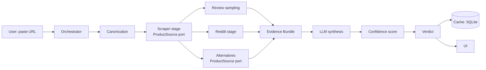
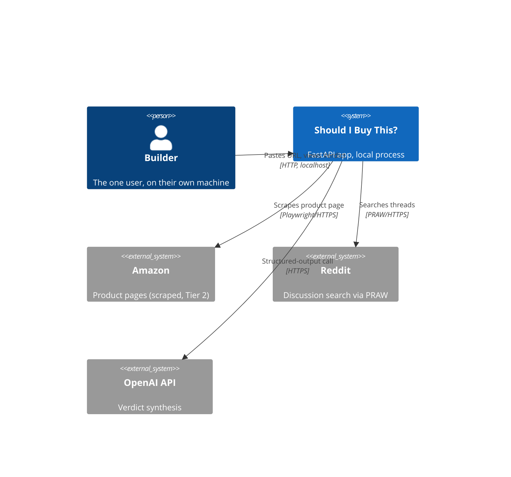

# Architecture Spine — Should I Buy This?

## Design Paradigm

**Pipes-and-Filters.** The product is one request pipeline: canonicalize → extract product facts → sample reviews → search Reddit → find alternatives → assemble an Evidence Bundle → LLM synthesis → compute confidence → cache. Each stage is a typed filter with one input and one output; a single orchestrator composes them. This maps directly onto the 8 feature branches (`scraper`, `reddit`, `alternatives`, `llm-synthesis`, `confidence-score`, `evidence-trail`, `caching`, `ui`) — see **Branch Ownership** below for exactly which modules each one owns, and which modules are shared core owned by none of them.

Locally, the product-fact-retrieval stage uses **Ports & Adapters**: a `ProductSource` port with one adapter per Source Tier (§AD-3). This is the only place a second pattern applies — everything else is plain pipes-and-filters.



## Branch Ownership

<!-- resolves rubric finding: every module must have an explicit owner, or be explicitly marked core/shared -->

| Branch | Owns |
| --- | --- |
| `scraper` | `pipeline/canonicalize.py` (AD-2), `pipeline/sources/scraper_tier2.py` + `degraded_tier3.py` (AD-3), `pipeline/reviews.py` (review sampling, FR-4/FR-5) |
| `reddit` | `pipeline/reddit.py` (AD-9) |
| `alternatives` | `pipeline/alternatives.py` (AD-3, AD-4, AD-9) |
| `llm-synthesis` | `pipeline/synthesis.py` (AD-5, AD-7, AD-9) |
| `confidence-score` | `pipeline/confidence.py` (AD-6) |
| `evidence-trail` | The citation-resolution step inside `synthesis.py`'s output validation (AD-7's citation rule) — `evidence-trail` is a cross-cutting concern realized at the point `Verdict.evidence_trail` is populated and checked, not a separate module. |
| `caching` | `cache/store.py` (AD-8) |
| `ui` | `web/`, and the route handlers in `main.py` other than `/jobs/{job_id}/events` itself (AD-7, AD-10) |
| **Core/shared — owned by none of the 8** | `pipeline/orchestrator.py` (AD-1, AD-8, AD-10), `pipeline/evidence.py` (AD-5), everything in `models/` (AD-1, AD-5, AD-7) — see AD-11 |

## Invariants & Rules

### AD-1 — Pipeline stage contract

- **Binds:** all 8 feature branches
- **Prevents:** stages built independently assuming different input/output shapes, or reaching into each other's internals
- **Rule:** Each pipeline stage is an async function taking one typed Pydantic input and returning one typed Pydantic output. A single orchestrator module sequences them. Stages never import or call another stage directly, and never redefine, subclass, or shadow a shared `models/` type locally — shared types are edited in place in `models/` (see AD-11).

### AD-2 — Canonical Product identity

- **Binds:** scraper, caching, alternatives, reddit
- **Prevents:** each stage inventing its own product-identity scheme (raw URL vs. ASIN vs. title-slug), breaking caching and coalescing
- **Rule:** One `canonicalize(url) -> CanonicalProductId` function, owned by the scraper branch, is the only source of the Canonical Product id. Every other stage and the cache key off this id; none derive their own.

### AD-3 — Data Source Port

- **Binds:** scraper, alternatives
- **Prevents:** scraper's Tier 2 logic (or any future Tier 1 API) being wired in incompatibly, or any stage that needs product-page data — including `alternatives`, which must fetch comparable-product facts — rolling its own ad-hoc fetcher instead of using the sanctioned port
- **Rule:** Product-fact retrieval goes through one `ProductSource` interface — `fetch(url) -> ProductFacts | SourceFailure` — with one implementation per Source Tier. Any stage needing product-page data calls this interface; none calls Playwright/BeautifulSoup or writes its own HTTP fetch directly. **v1 ships only the Tier 2 (scraper) and Tier 3 (degraded) implementations** — see Deferred for why Tier 1 isn't built yet. Side effect worth naming: because Tier 1 (Keepa price history) is deferred, `ProductFacts` never carries price-history data in v1 at all — so PRD FR-9's "Wait never reasons about price trends" constraint is structurally true, not just a prompting instruction to remember.

### AD-4 — Honest failure, no fabrication

- **Binds:** scraper, reddit, alternatives, llm-synthesis
- **Prevents:** a stage returning fabricated or partially-invented data disguised as success; a stage's degraded/failed result being silently flattened into a "confirmed empty" value one hop downstream
- **Rule:** Every stage returns either a populated typed result or an explicit typed failure/sentinel — never `None`-as-success, never a partial object treated as complete. That sentinel is preserved as a distinct value all the way through `pipeline/evidence.py`'s assembly into `EvidenceBundle` (e.g. `reddit_evidence: RedditEvidence | DegradedReddit`, not coerced to an empty list) — `llm-synthesis` and `confidence-score` must be able to tell "genuinely nothing found" apart from "this source degraded." The orchestrator maps a scraper-stage failure specifically to PRD FR-3's "insufficient data" result rather than letting it propagate into Evidence Bundle assembly.

### AD-5 — Evidence Bundle is the only LLM input

- **Binds:** llm-synthesis
- **Prevents:** a future change piping raw HTML, review text, or Reddit threads directly into a prompt, bypassing the schema; fact data getting silently rewritten by a probabilistic step
- **Rule:** The llm-synthesis stage's only input type is the finalized `EvidenceBundle` model. It has no access to scraper/reddit/alternatives internals or raw text — only the assembled, schema-validated bundle. Within that bundle, fact fields (price, specs — exact, sourced directly from `ProductFacts`) are a distinct, separately-typed section from opinion-bearing fields (review/Reddit excerpts — probabilistic); `synthesis.py` may read both but must pass fact fields through to the final `Verdict` unmodified, never inferred or rewritten.

### AD-6 — Confidence Score computed outside the LLM

- **Binds:** llm-synthesis, confidence-score
- **Prevents:** confidence logic being wired into the LLM call path; `confidence-score` and `evidence-trail`/`llm-synthesis` both trying to own the "why is this uncertain" narrative
- **Rule:** `compute_confidence(evidence: EvidenceBundle) -> float` is a deterministic, LLM-free function in its own module, returning a float only — never narrative text. llm-synthesis calls it after receiving the LLM's Verdict draft and overwrites the confidence field with it; any confidence value the LLM produced is discarded. The "why" narrative lives entirely in `Verdict.reasoning_summary` (AD-7), written by the LLM — `confidence-score` never writes prose, `llm-synthesis` never computes the number.

### AD-7 — Verdict schema is the single frontend contract

- **Binds:** llm-synthesis, evidence-trail, confidence-score, ui
- **Prevents:** the UI and the synthesis stage drifting on field names or shapes; a Verdict reaching the UI that fails schema validation or contains a citation that doesn't resolve to a real `EvidenceBundle` item
- **Rule:** One `Verdict` Pydantic model is used for (a) OpenAI structured-output enforcement, (b) the FastAPI response model, and (c) what the UI template renders — defined once in `models/`, imported by both sides, never duplicated or hand-rolled. It carries a `schema_version: int` field, bumped on any breaking change; a consumer (UI, cache reader) that expects a different version treats it as incompatible rather than guessing. Required fields beyond the base verdict/pros/cons/alternatives/reasoning_summary:
  - `confidence: float` (AD-6) plus `evidence_basis: EvidenceBasis` — a small structured object (e.g. `review_count`, `reddit_thread_count`) so the UI can always render "based on N reviews and M Reddit threads" next to the score (PRD FR-12), never the number alone.
  - `persona_results: list[PersonaResult]` plus `persona_disagreement: bool` (PRD Open Question 5's data contract; the `ui` branch owns how disagreement is displayed).
  - `sentiment_divergence: bool` (PRD FR-7's Reddit-vs-review sentiment cross-check), set by the data assembled in `EvidenceBundle`, surfaced the same way `persona_disagreement` is.
  - `evidence_trail: list[Citation]`, where each `Citation` points at a specific item that must exist in the `EvidenceBundle` that produced this Verdict. If `synthesis.py`'s structured-output call returns a citation that doesn't resolve, that is a validation failure (see below), not a Verdict the UI ever sees.

  **Validation failure handling:** if the LLM's structured-output response fails schema validation (missing field, malformed citation, wrong type), `synthesis.py` retries once with the validation error appended to the prompt; if that retry also fails, the orchestrator treats it as a stage failure under AD-4 (PRD FR-3's "insufficient data" result) — never a hand-patched or partially-valid Verdict reaches the UI.

### AD-8 — Caching and coalescing keyed on Canonical Product Id

- **Binds:** caching, all stages
- **Prevents:** concurrent requests for the same product independently re-running the pipeline, or a cache keyed on something other than AD-2's id
- **Rule:** One cache/lock module owns an `asyncio.Lock` registry keyed by Canonical Product Id. The orchestrator checks cache → acquires lock → runs pipeline → writes cache → releases. No stage writes its own ad-hoc cache. A cache hit returns the stored `Verdict` directly from the initial request — no job is created and the UI never opens an SSE connection at all (see AD-10's note); SSE only applies on a cache miss.

### AD-9 — Graceful degradation on external dependency failure

- **Binds:** reddit, scraper, alternatives, llm-synthesis
- **Prevents:** a rate-limited or unavailable external dependency — Reddit, a blocked scrape, or a slow/erroring OpenAI call — blocking or crashing the whole request
- **Rule:** Every call to an external dependency (Reddit via PRAW, Amazon via the scraper, OpenAI) is wrapped with a timeout plus one retry, then degrades to an explicit empty/partial/failure result consumed by AD-4. None raises an unhandled exception out of its stage. This is the generic mechanism; whether it's sufficient for real day-to-day PRAW rate limits (PRD Open Question 8) is unverified until the tool is used for real — see Deferred.

### AD-10 — Progress reporting via Server-Sent Events

- **Binds:** ui, orchestrator
- **Prevents:** the `ui` branch assuming a different progress mechanism than the backend emits; the orchestrator writing progress wherever is convenient instead of through one defined channel
- **Rule:** Each pipeline stage, on entry, publishes its name to a per-job `asyncio.Queue` the orchestrator creates when a job starts (cache miss only — see AD-8). `GET /jobs/{job_id}/events` is a `StreamingResponse` (`text/event-stream`) that reads that queue and yields one SSE event per stage transition, then a final event carrying the `Verdict` (or the FR-3 "insufficient data" result) and closes the stream. The UI consumes it with `EventSource`. No WebSocket, no separate polling endpoint. Resolves PRD Open Question 2.
- **Note:** reconsidered from an earlier polling-only draft — for a single local user there's no concurrency/scale reason to prefer polling, and SSE better serves FR-16's "visible progress" intent (per-stage, not just a spinner). The one real cost is that the orchestrator must explicitly publish progress (a straight-line async pipeline doesn't emit events on its own) — the `asyncio.Queue` above is that mechanism, kept to the one rule so `ui` and `orchestrator` can't drift on its shape.

### AD-11 — Core/shared modules are not owned by any single branch

- **Binds:** all 8 feature branches
- **Prevents:** two branches independently shaping shared plumbing — the `EvidenceBundle` schema, the orchestrator's control flow — in incompatible ways because neither "owned" it
- **Rule:** `pipeline/orchestrator.py`, `pipeline/evidence.py`, and everything in `models/` are core/shared (see Branch Ownership table). Any branch may edit them in place when its work requires it, but never fork, subclass, or shadow them locally. A change to any of these three must keep every AD that binds them satisfied (AD-1, AD-5, AD-7, AD-8, AD-10) — it is not any single branch's unilateral call, since drift here breaks every branch downstream of it at once.

## Consistency Conventions

| Concern | Convention |
| --- | --- |
| Naming | Canonical Product Id format: `amazon:{ASIN}`. Model names match the PRD Glossary exactly: `CanonicalProduct`, `EvidenceBundle`, `Verdict`, `ProductFacts`. `confidence`, `evidence_basis`, and `evidence_trail` are fields on `Verdict`, not separate models. |
| Data & formats | Timestamps: ISO 8601 UTC. Confidence Score: `float` in `[0.0, 1.0]`. Stage errors: typed failure/sentinel objects (AD-4), never bare exceptions crossing a stage boundary. |
| State & cross-cutting | Logging: Python stdlib `logging`, one logger per stage module, structured (JSON) output. Config: a single `pydantic-settings` `Settings` object; no scattered `os.getenv`. Auth: none — single local user (PRD non-goal), no session/account model anywhere in the stack. |
| Secrets | OpenAI API key and Reddit/PRAW client id+secret are environment variables only, loaded through `Settings` — never hard-coded, never logged. `.env` is in `.gitignore` from the first commit; this is non-negotiable on a public MIT-licensed repo. |
| Observability | The scraper branch additionally logs field-level null-rates per extraction and logs a `WARNING` when null-rates spike (the signal a site redesign broke the scraper); contract-test the scraper against saved HTML fixtures where practical. |

## Stack

<!-- versions verified via web research during this run; confidence noted per row. Re-verify against PyPI/the tool's own release notes before pinning in pyproject.toml — several of these move fast. -->

| Name | Version | Confidence |
| --- | --- | --- |
| Python | 3.12+ | Medium — 3.14 looked like current mainline; verify current 3.x at setup |
| FastAPI | >=0.115 | Low — exact patch churns fast, verify on PyPI at setup |
| Pydantic | ~=2.13 | Medium — verify at setup |
| Uvicorn | >=0.47 | Medium — verify at setup |
| Playwright (Python) | ~=1.62 | Medium-high — verify at setup |
| beautifulsoup4 | >=4.12 | High — slow-moving, low version risk |
| praw | >=7.7 | Low — at least 7.7.0 confirmed; verify latest 7.x at setup |
| openai (Python SDK) | latest at setup | Medium — must support Structured Outputs; verify whether to target the Chat Completions shape (`response_format={"type":"json_schema",...}`) or the newer Responses API shape (`text.format`) against current SDK docs, not this spine |
| aiosqlite | ~=0.22 | Medium-high |
| pytest | >=9.0 | Medium — 9.0 shipped breaking changes vs. 8.x; verify at setup |
| ruff | ~=0.16 | Medium — 0.16 changed the default rule set (59→413 rules) vs. 0.15; verify at setup |
| GitHub Actions: actions/checkout | v7 | Medium — verify at setup |
| GitHub Actions: actions/setup-python | v7 | Medium — verify at setup |

No job queue (Celery/ARQ) — a single orchestrator run via FastAPI `BackgroundTasks`/`asyncio.create_task` is sufficient at this scale; job status lives in the same SQLite store as the evidence cache. Owned entirely by the `caching`/core-shared orchestrator, not a cross-branch divergence risk, so not elevated to an AD.

`llm-synthesis` makes two LLM calls, not one: a cheaper model for review/Reddit theme clustering (pre-processing before the Evidence Bundle is finalized) and a stronger model for the final structured Verdict synthesis — both model names configured via `Settings`, swappable independently. Single-branch cost-control detail, not elevated to an AD.

## Structural Seed



**Deployment & environments:** local-only in v1 — the app runs on the builder's own machine; no staging or production hosting exists (PRD non-goal). CI runs only in ephemeral GitHub Actions runners; there is no deployment target yet. SQLite is a single file on disk, no separate database server.

```text
should-i-buy-this/
  app/
    main.py              # FastAPI app + routes: GET /health, GET /jobs/{job_id}/events (SSE, AD-10), POST / (submit URL)
    settings.py          # pydantic-settings Settings - config AND secrets (see Consistency Conventions)
    models/               # core/shared (AD-11): CanonicalProduct, EvidenceBundle, Verdict, ProductFacts
    pipeline/
      orchestrator.py      # core/shared (AD-11): sequences stages, owns cache/lock (AD-8), SSE queue (AD-10)
      canonicalize.py       # scraper branch - AD-2
      sources/               # scraper branch - AD-3 Data Source Port
        base.py               # ProductSource interface
        scraper_tier2.py       # Playwright + BeautifulSoup
        degraded_tier3.py      # URL-slug + search fallback
      reviews.py             # scraper branch - stratified review sampling, FR-4/FR-5
      reddit.py              # reddit branch - PRAW search + relevance filter + sentiment cross-check (AD-9)
      alternatives.py        # alternatives branch - uses the AD-3 port, never its own fetcher
      evidence.py            # core/shared (AD-11): assembles EvidenceBundle, preserves degraded sentinels (AD-4)
      synthesis.py           # llm-synthesis branch - two LLM calls (cheap cluster + strong synthesis), AD-5, AD-7
      confidence.py          # confidence-score branch - AD-6, pure function
    cache/
      store.py              # caching branch - SQLite/aiosqlite: evidence+verdict cache, job status (AD-8)
    web/
      templates/             # ui branch - Jinja2
      static/
  tests/                   # mirrors app/pipeline/* one-to-one
  .github/workflows/ci.yml
  pyproject.toml
```

**CI/CD (`.github/workflows/ci.yml`):** triggers on `pull_request` targeting `main` (gates the merge) and `push` to `main` (post squash-merge safety net). Three jobs: **lint** (`ruff check`), **test** (`pytest`), **smoke** (boot the app via FastAPI's `TestClient` and hit `GET /health` — this already exercises app construction, routing, and settings loading, where most startup failures occur, without the complexity of spawning a real `uvicorn` subprocess). Recommended repo setting (not architecture, noted for completeness): branch protection on `main` requiring these checks, with squash-merge enabled, matching the stated workflow.

## Capability → Architecture Map

| Capability / Area | Lives in | Governed by |
| --- | --- | --- |
| FR-1, FR-2, FR-3 (extraction) | `pipeline/canonicalize.py`, `pipeline/sources/` | AD-2, AD-3, AD-4 |
| FR-4, FR-5 (review sampling) | `pipeline/reviews.py` | AD-1, AD-4 |
| FR-6, FR-7 (Reddit signal) | `pipeline/reddit.py` | AD-1, AD-4, AD-9 |
| FR-8 (alternatives) | `pipeline/alternatives.py` | AD-1, AD-3, AD-4, AD-9 |
| FR-9, FR-10, FR-12 (verdict synthesis, evidence trail) | `pipeline/synthesis.py`, `models/` | AD-3, AD-5, AD-7, AD-9, AD-11 |
| FR-11 (confidence score) | `pipeline/confidence.py` | AD-6, AD-7 |
| FR-13, FR-14 (caching, coalescing) | `cache/store.py`, `pipeline/orchestrator.py` | AD-2, AD-8, AD-11 |
| FR-15, FR-16 (web UI, progress) | `web/`, `main.py` | AD-7, AD-8, AD-10 |

## Deferred

- **Tier 1 paid API integration** (Rainforest/Keepa or similar). Research during this run found neither has a real free tier (Rainforest: ~100-request trial then paid from ~$18/mo; Keepa API: no free tier, from ~€49/mo) — this contradicts the original brainstorm's "free tier available" assumption. `[ASSUMPTION]` v1 runs on Tier 2 (scraper) only; AD-3's port means a paid API can be added later without touching the rest of the pipeline. A useful side effect while deferred: no price-history data exists in v1 at all, so PRD FR-9's "Wait means inconclusive evidence, never a price-trend prediction" is structurally enforced, not just a prompting discipline. Revisit if scraping reliability or Amazon's ToS risk becomes a real problem before a paid API is worth it either way.
- **Confidence Score formula weights and low-confidence threshold** (PRD Open Question 4) — owned entirely by the `confidence-score` branch behind AD-6's interface; tune empirically, no cross-branch risk.
- **Multi-persona disagreement visual treatment** (PRD Open Question 5) — data contract fixed by AD-7 (`persona_results`, `persona_disagreement`); the actual UI design is the `ui` branch's call.
- **FR-5/FR-8 numeric defaults** (review-count threshold, price-band width) — implementation constants consumed only within their owning branch; not a cross-branch contract.
- **Acceptable wait time (PRD SM-2)** — no hard target; informs timeout tuning in AD-9 informally, not a binding constraint.
- **PRD Open Question 8 (Reddit/PRAW rate limits at real usage volume)** — AD-9's timeout+retry+degrade is the generic mechanism, but whether that's actually sufficient for daily personal use (vs. needing a longer backoff, a request budget, or caching Reddit results separately from the 48h product cache) is unverified until the tool sees real use. Revisit if degraded-Reddit results become frequent in practice.
- **Legal/ToS risk of scraping Amazon** is now higher-stakes than the original brainstorm assumed, since Tier 2 is the *only* implemented source in v1 rather than a fallback behind a free Tier 1 API. Partially mitigated by the 48h cache (AD-8) reducing request volume. Revisit alongside the Tier 1 deferral above if this becomes a practical problem.
- **Near-duplicate review clustering** (addendum detail under FR-4) and the exact Reddit query template/subreddit scoping (addendum detail under FR-6) — implementation detail fully owned by the `scraper` and `reddit` branches respectively; no cross-branch contract depends on the exact method, only on the typed output each branch already must produce (AD-1, AD-4).
- **Non-Amazon retailers** — out of scope per PRD; AD-3's port is the seam a second scraper/API adapter would plug into later.
